<div align="center">

<a href="https://larissahorrara.github.io/gestaodeleitos/">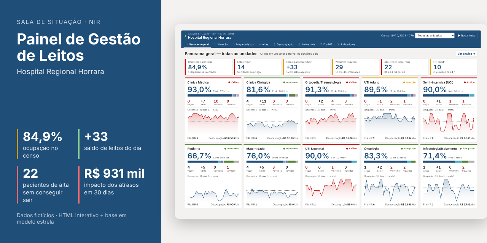</a>

# Painel de Gestão de Leitos — Hospital Regional Horrara


<a href="https://larissahorrara.github.io/gestaodeleitos/"></a>
<a href="data/base-dados-leitos.xlsx"></a>

<a href="https://larissahorrara.github.io/gestaodeleitos/"><strong>Abrir o painel</strong></a> · [Telas](#galeria) · [Insights](#5-insights-da-análise) · [Base de dados](#6-base-de-dados) · [Medidas DAX](#7-medidas-para-o-power-bi-dax) · [Regras de negócio](#8-regras-de-negócio) · [Glossário](#13-glossário)

</div>

Relatório gerencial interativo de gestão de leitos hospitalares. Ele reúne o censo hospitalar, o mapa de leitos, o Kanban de permanência e de altas, o balanço de leitos do dia, o giro e a higienização, a fila do Núcleo Interno de Regulação (NIR), os indicadores assistenciais e o custo dos pacientes que recebem alta médica mas não conseguem deixar o leito. O painel foi pensado para a sala de situação do NIR e para a gestão do hospital.

> **Aviso:** todos os nomes, unidades, pacientes, prontuários e valores são fictícios, gerados para demonstração. O "Hospital Regional Horrara" não existe. Nenhum dado se refere a pessoas ou instituições reais.

## Sumário

1. [Objetivo e público](#1-objetivo-e-público)
2. [Estrutura do repositório](#2-estrutura-do-repositório)
3. [Como abrir e usar o relatório](#3-como-abrir-e-usar-o-relatório)
4. [Telas do relatório](#4-telas-do-relatório)
5. [Insights da análise](#5-insights-da-análise)
6. [Base de dados](#6-base-de-dados)
7. [Medidas para o Power BI (DAX)](#7-medidas-para-o-power-bi-dax)
8. [Regras de negócio](#8-regras-de-negócio)
9. [Arquitetura técnica do HTML](#9-arquitetura-técnica-do-html)
10. [Como os dados fictícios foram gerados](#10-como-os-dados-fictícios-foram-gerados)
11. [Como usar com dados reais](#11-como-usar-com-dados-reais)
12. [Referências normativas e técnicas](#12-referências-normativas-e-técnicas)
13. [Glossário](#13-glossário)
14. [Limitações e cuidados](#14-limitações-e-cuidados)
15. [Histórico de versões](#15-histórico-de-versões)

---

## 1. Objetivo e público

O painel responde, numa só tela, a três perguntas do dia a dia da gestão de leitos: **quantos leitos temos agora**, **quantos vão sobrar ou faltar hoje** e **o que está impedindo os leitos de girar**. Ele também mede, em reais, o custo dos atrasos na desocupação, para apoiar a priorização de ações com o Serviço Social, o transporte sanitário e a regulação.

| Público | Uso principal |
|---|---|
| Núcleo Interno de Regulação (NIR) | Acompanhar a ocupação, o saldo de leitos do dia e a fila de pedidos em tempo real, na TV da sala de situação |
| Diretoria e gerência assistencial | Ver o panorama do hospital, comparar unidades e acompanhar metas de ocupação e permanência |
| Coordenações de unidade | Conduzir o round diário pelo Kanban: pacientes em vermelho, altas previstas e pendências |
| Serviço Social, transporte e regulação | Destravar os pacientes de alta que não conseguem sair, com o motivo, o tempo e o custo de cada caso |
| Hotelaria e higienização | Acompanhar leitos em limpeza, tempos-alvo e o giro do leito |
| Planejamento, custos e faturamento | Estimar o custo da espera e a receita de AIH que deixou de entrar |

## 2. Estrutura do repositório

```text
gestaodeleitos/
├── index.html                      # o painel em arquivo único (abre direto no navegador e no GitHub Pages)
├── README.md                       # este documento
├── CHANGELOG.md                    # histórico de versões
├── package.json                    # atalho para o script de extração (Node.js)
├── requirements.txt                # dependências dos scripts Python (pandas e openpyxl)
├── .gitignore                      # ignora a pasta build/, gerada pelos scripts
├── data/
│   ├── base-dados-leitos.xlsx      # base em modelo estrela, com LEIA-ME, Conferencia e Dicionario
│   ├── dados.json                  # extração bruta de todas as tabelas (data de referência e linhas)
│   └── csv/                        # uma cópia em CSV por tabela da base
│       ├── dUnidade.csv
│       ├── dLeito.csv
│       ├── dCalendario.csv
│       ├── dProcedimento.csv
│       ├── dMotivoDesocupacao.csv
│       ├── dComponenteCusto.csv
│       ├── fCensoDiario.csv
│       ├── fLeitosCenso.csv
│       ├── fSaidas.csv
│       ├── fSolicitacoes.csv
│       ├── fCustoDiaria.csv
│       ├── fAtrasosDesocupacao.csv
│       ├── dMetas.csv
│       └── Dicionario.csv
├── docs/
│   ├── img/                        # telas do painel e imagem de pré-visualização social
│   └── configuracao-github.md      # passo a passo para publicar o repositório e o GitHub Pages
└── scripts/
    ├── extrair_dados.js            # index.html → build/bases.json e build/calculos.json
    └── montar_base.py              # build/ → data/base-dados-leitos.xlsx, data/csv/ e data/dados.json
```

O painel (`index.html`) carrega os dados embutidos no próprio arquivo. A base em Excel e os CSV trazem exatamente as mesmas linhas, para uso no Power BI, no Excel ou em outra ferramenta.

## 3. Como abrir e usar o relatório

1. Acesse o link **[Abrir o painel](https://larissahorrara.github.io/gestaodeleitos/)**, no topo desta página, ou baixe o repositório e dê dois cliques em `index.html`.
2. O painel abre no Google Chrome, no Microsoft Edge ou no Firefox. Não é preciso instalar nada e o arquivo baixado funciona sem internet.
3. Use a lista **Unidade**, na barra azul, para ver o hospital todo ou um setor.
4. Navegue pelas oito telas na barra superior, pelo teclado (teclas **1** a **8** e setas) ou ligue o **Rodar telas** para o rodízio automático a cada 25 segundos.
5. Para usar numa TV, abra em tela cheia com **F11**.
6. Clique em qualquer barra de gráfico para ver o balão com a explicação daquela medida.
7. Use **Ver análise →** em cada tela para abrir as tabelas detalhadas, os filtros e a metodologia. **← Voltar à sala de situação** retorna às telas.

**Dependências externas:** nenhuma. A biblioteca de gráficos (D3.js 7.9) e os dados estão embutidos no HTML.

| Recurso da interface | Como funciona |
|---|---|
| Filtro de unidade | Lista na barra azul; vale para todas as telas e para a análise completa |
| Cartões do Panorama | Clique em um setor para filtrá-lo e abrir a tela Situação |
| Balão de explicação | Passar o mouse mostra a prévia; clicar fixa o balão com valores, definição e como interpretar; fecha no ✕ ou clicando fora |
| Ação no balão | No gráfico de ocupação, o botão "Ver só esta unidade" aplica o filtro |
| Rodízio de telas | Botão "Rodar telas" ou barra de espaço; pausa automaticamente na análise completa |
| Ficha do leito | No mapa de leitos, clique em um leito para ver paciente, permanência, etapa e pendência |
| Tabelas ordenáveis | Na análise completa, clique no cabeçalho da coluna |
| Bases em CSV | Na aba Metodologia da análise completa, botões para baixar cada base |

## 4. Telas do relatório

| # | Tela | Pergunta que responde | Conteúdo |
|---|---|---|---|
| 1 | Panorama geral | Como está cada setor agora? | Totais do hospital e um cartão por unidade: ocupação, barra de situação dos leitos, vagos, saldo, vermelhos, travados, minigráfico de 30 dias, fila do NIR e custo diário da desocupação |
| 2 | Situação | Onde está a pressão? | Quatro indicadores com semáforo, ocupação por unidade e rosca da situação dos leitos |
| 3 | Mapa de leitos | Qual é a situação de cada leito? | Os 230 leitos por unidade, coloridos pelo Kanban de permanência, com ficha ao clicar |
| 4 | Altas | Quem precisa sair e o que impede? | Quatro colunas: passaram do prazo, alta prevista hoje, com alta saindo hoje, com alta mas sem conseguir sair |
| 5 | Desocupação | Quanto custa o paciente de alta que não sai? | Travados agora, custo por dia, custo em 30 dias e custo por motivo |
| 6 | Leitos hoje | Vão sobrar ou faltar leitos? | Balanço do dia em cascata e horário das saídas |
| 7 | Fila do NIR | Quem espera leito e há quanto tempo? | Pedidos pendentes, maior espera, atendidos em até 6 h e lista da fila |
| 8 | Indicadores | Como foi o mês? | Ocupação, permanência, giro e mortalidade institucional, com a ocupação diária comparada à meta |

A **análise completa** (botão "Ver análise →") traz dez abas detalhadas: Resumo comentado, Painel de leitos com filtros, Visão geral, Censo hospitalar, Indicadores e KPIs, Giro de leitos, Desocupação e custos, Demanda e NIR, Kanban e Metodologia.

### Galeria

Clique em qualquer tela para abrir a página correspondente no painel interativo.

| Panorama geral | Situação |
|---|---|
| [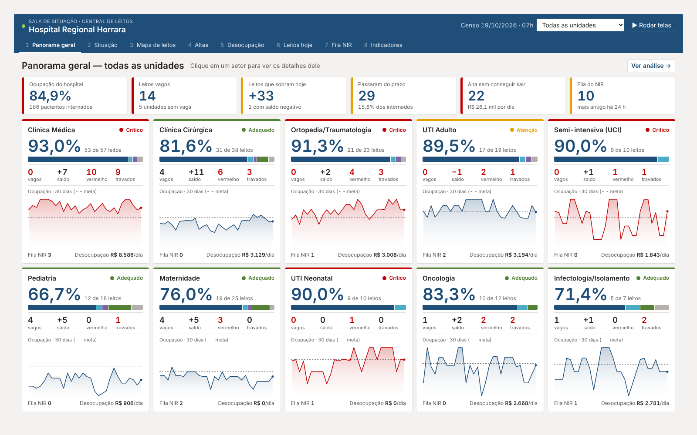](https://larissahorrara.github.io/gestaodeleitos/#panorama) | [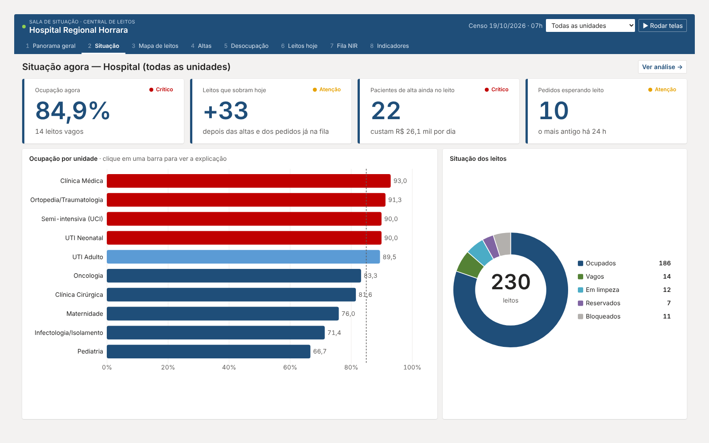](https://larissahorrara.github.io/gestaodeleitos/#situacao) |
| **Mapa de leitos** | **Altas (Kanban)** |
| [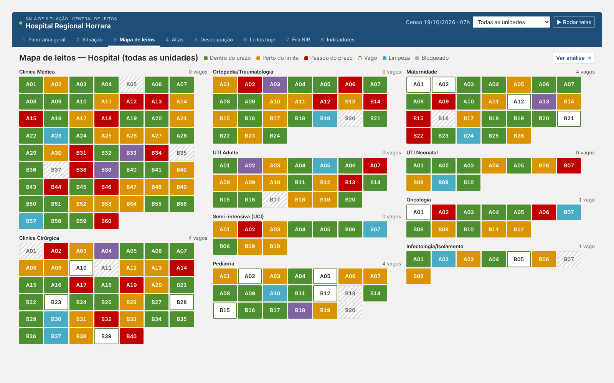](https://larissahorrara.github.io/gestaodeleitos/#mapa) | [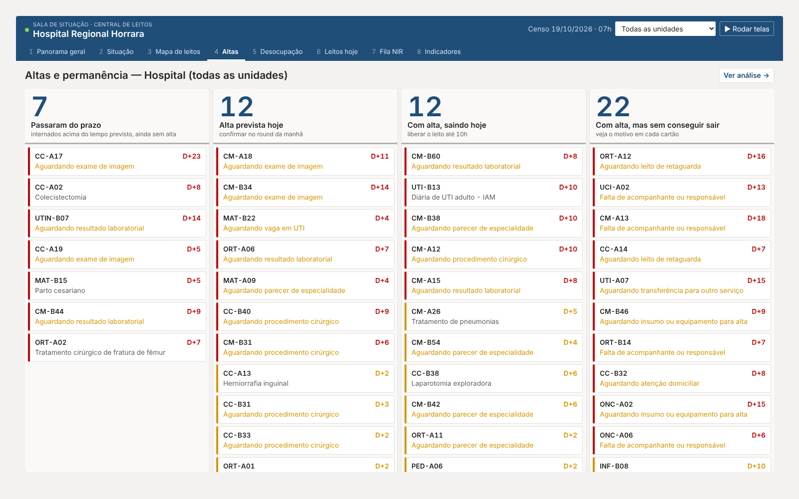](https://larissahorrara.github.io/gestaodeleitos/#quadro-kanban) |
| **Desocupação e custos** | **Leitos hoje** |
| [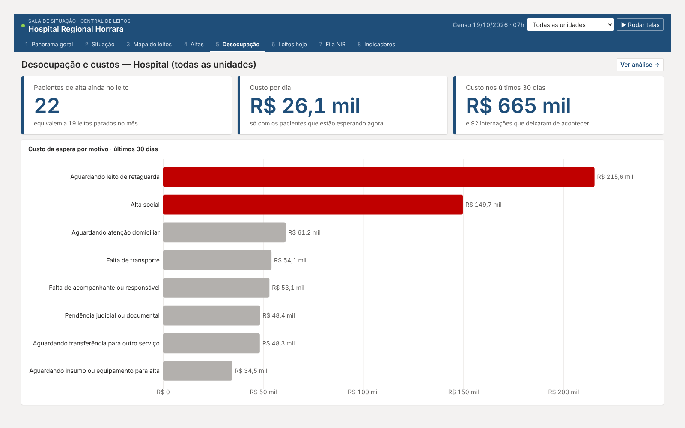](https://larissahorrara.github.io/gestaodeleitos/#custos-desocupacao) | [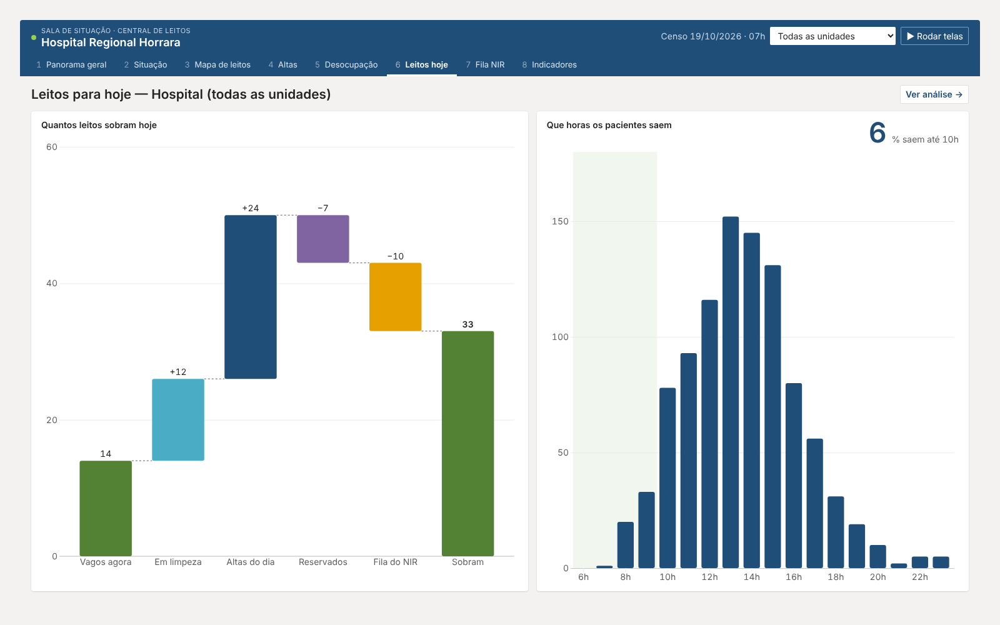](https://larissahorrara.github.io/gestaodeleitos/#fluxo-do-dia) |
| **Fila do NIR** | **Indicadores do mês** |
| [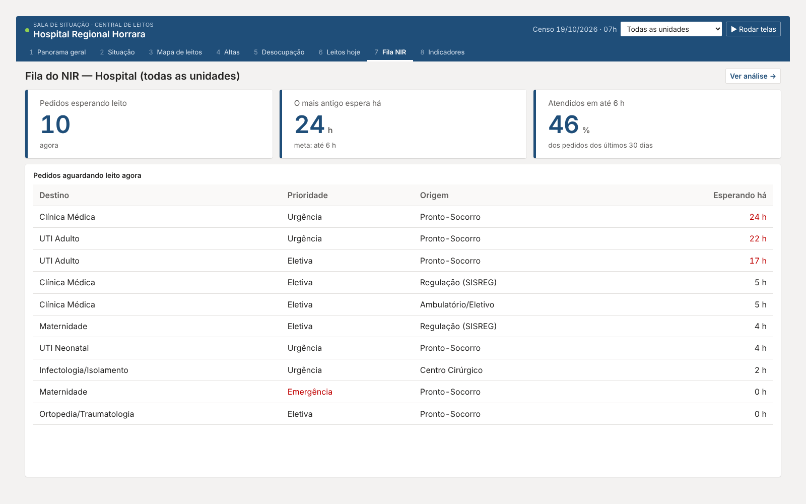](https://larissahorrara.github.io/gestaodeleitos/#fila-nir) | [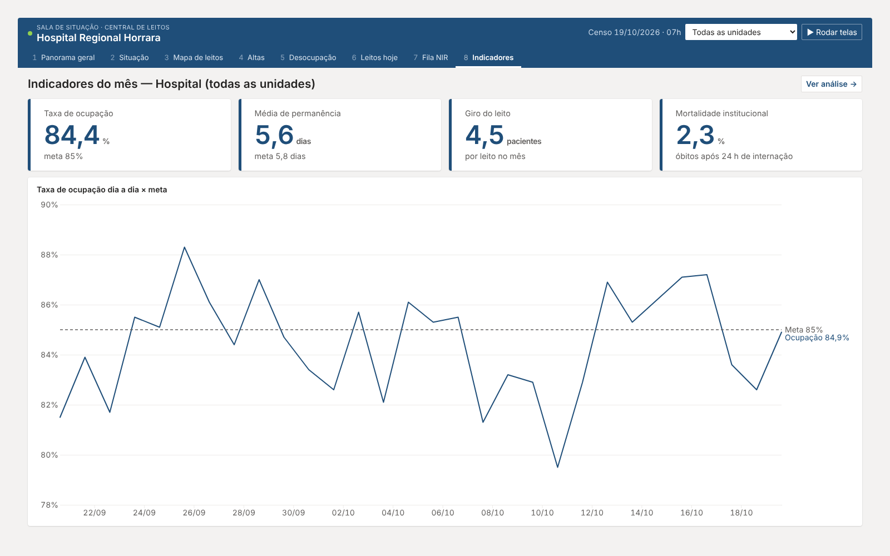](https://larissahorrara.github.io/gestaodeleitos/#indicadores-mes) |
| **Análise completa: resumo comentado** | **Análise completa: painel de leitos** |
| [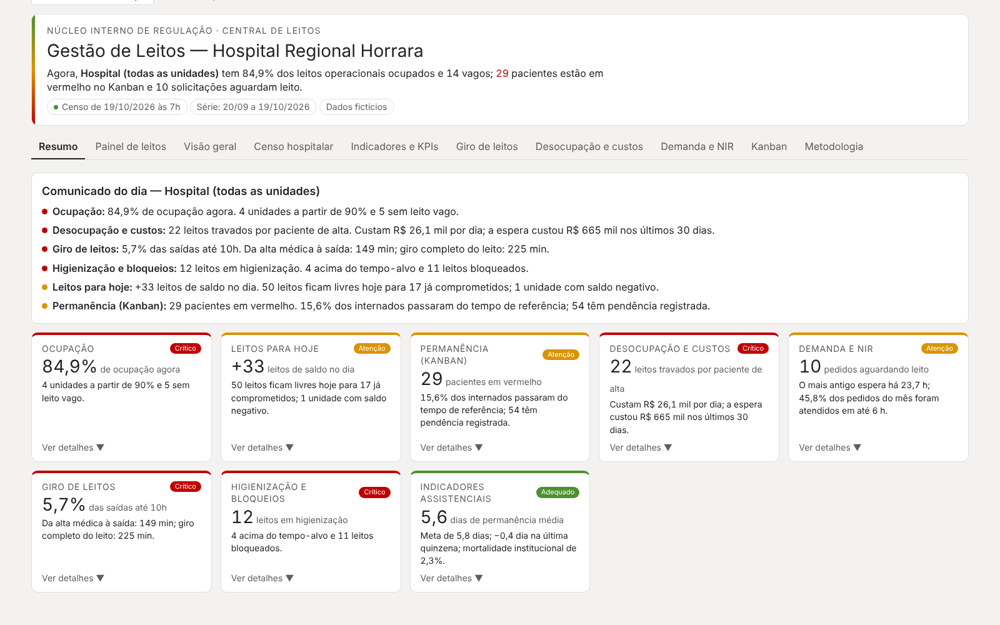](https://larissahorrara.github.io/gestaodeleitos/#resumo) | [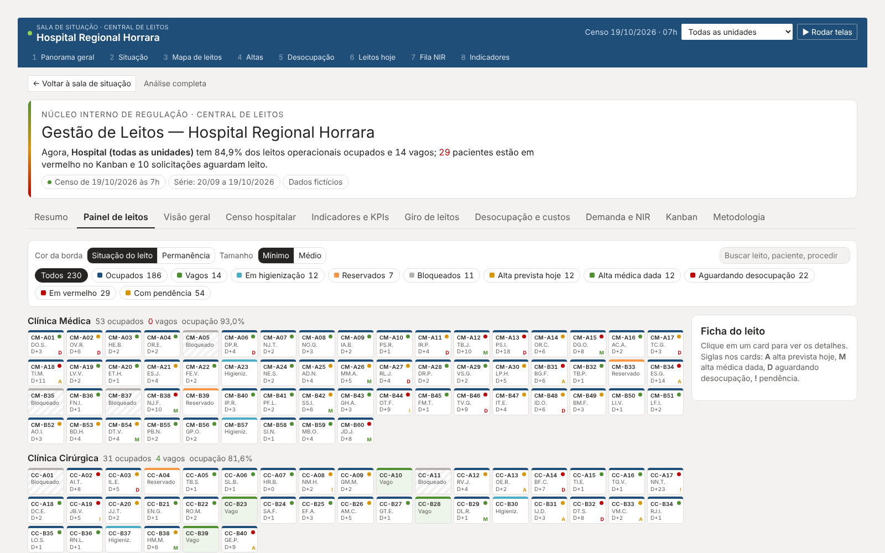](https://larissahorrara.github.io/gestaodeleitos/#painel-leitos) |

**Paleta temática**

| Uso | Cor |
|---|---|
| Barra superior, números e séries principais | Azul institucional `#1F4E79` |
| Situação crítica, Kanban vermelho | `#C00000` |
| Atenção, Kanban amarelo | `#E6A100` |
| Adequado, leito vago, Kanban verde | `#548235` |
| Em limpeza | `#4BACC6` |
| Reservado | `#8064A2` |
| Bloqueado, unidades fora do filtro | `#B3B0AD` |
| Fundo e cartões | `#F3F2F1` e `#FFFFFF` |

## 5. Insights da análise

Valores do censo de **19/10/2026 às 7h** e dos **30 dias** entre 20/09 e 19/10/2026.

### 5.1 A ocupação está no limite em quatro unidades

- A ocupação do hospital nos 30 dias foi de **84,4%**, colada na meta de 85%. No censo, está em **84,9%**, com **14 leitos vagos** em 219 operacionais.
- **Clínica Médica (93,0%)**, **Ortopedia (91,3%)**, **Semi-intensiva (90,0%)** e **UTI Neonatal (90,0%)** estão a partir de 90%.
- **Cinco unidades estão sem nenhum leito vago:** Clínica Médica, Ortopedia, UTI Adulto, Semi-intensiva e UTI Neonatal.
- A Clínica Médica ficou a partir de 90% em **25 dos 30 dias** (**94,3%** de média, com dias a 100%).

### 5.2 O saldo do dia é positivo, mas mal distribuído

| Componente do balanço | Leitos |
|---|---|
| Vagos agora | 14 |
| Em limpeza | 12 |
| Altas previstas ou já dadas | 24 |
| Reservados | −7 |
| Fila do NIR | −10 |
| **Saldo do dia** | **+33** |

- A sobra está concentrada na Clínica Cirúrgica (**+11**) e na Clínica Médica (**+7**, que depende das altas do dia).
- A **UTI Adulto fecha o dia com saldo negativo (−1)**: dois leitos liberam e três já estão comprometidos.

### 5.3 A permanência passa da meta nas unidades de maior complexidade

| Unidade | Média de permanência | Meta | Diferença |
|---|---|---|---|
| Infectologia/Isolamento | 12,1 dias | 9,0 | **+3,1** |
| UTI Adulto | 10,2 dias | 7,0 | **+3,2** |
| Oncologia | 10,1 dias | 8,0 | **+2,1** |
| Clínica Médica | 7,7 dias | 6,5 | **+1,2** |
| Hospital | 5,6 dias | 5,8 | −0,2 |

- **29 pacientes (15,6% dos internados) estão em vermelho** no Kanban, ou seja, acima do tempo de referência do procedimento.
- **54 pacientes têm pendência registrada.** As barreiras clínicas mais frequentes são resultado laboratorial (9), parecer de especialidade (8) e exame de imagem (7).

### 5.4 As altas saem tarde

- Só **5,7% das saídas acontecem até as 10h** (meta de 30%), e **23,2% até as 12h**.
- O pico de saídas é entre **13h e 16h** (152, 145 e 131 saídas no mês nessas três horas).
- Da alta médica à saída física do paciente passam **149 minutos** na mediana, acima do alvo de 120.

### 5.5 O giro do leito leva quase quatro horas

- Da saída do paciente até a nova ocupação, o leito fica parado **225 minutos** na mediana.
- A higienização leva **53 min** (concorrente 48 min, terminal 98 min) e começa **26 min** após a saída.
- A etapa mais longa é a de **leito liberado até a nova ocupação: 130 minutos**, que indica demora na alocação do paciente.
- No censo, **4 higienizações estão acima do tempo-alvo** (ORT-B19, UTIN-B09, CC-B37 e UCI-B07).

### 5.6 A fila do NIR atende, mas devagar

- Em 30 dias foram **831 pedidos de leito**, com **92,5% atendidos**.
- A mediana de espera é de **6,7 h**, e o percentil 90 chega a **20,7 h**. Só **45,8%** dos pedidos são atendidos em até 6 h.
- As maiores esperas medianas são da **UTI Adulto (10,5 h)**, da **Clínica Médica (9,5 h)** e da **Infectologia (9,1 h)**.
- **10 pedidos aguardam leito agora.** O mais antigo espera há **23,7 h**: urgência do pronto-socorro para a Clínica Médica.

### 5.7 Pacientes de alta que não saem custam R$ 931 mil por mês

- Foram **181 episódios** de atraso na desocupação, somando **578,9 leitos-dia (8,7% dos leitos-dia operacionais)**, o equivalente a **19,3 leitos parados o mês inteiro**.
- O custo da espera foi de **R$ 665.016**. Somando a receita de AIH que deixou de entrar (**R$ 266.788**), o impacto chega a **R$ 931.804** em 30 dias.
- A ocupação desses leitos impediu cerca de **92 novas internações**.
- **Leito de retaguarda (R$ 215.554)** e **alta social (R$ 149.741)** respondem por **55% do custo**.
- **22 pacientes estão travados agora**, custando **R$ 26.115 por dia**. Se nada mudar, são **R$ 783 mil** em 30 dias.
- A **equipe assistencial é 54,4%** do custo da espera: o leito ocupado por quem já teve alta continua consumindo enfermagem e equipe médica.

### 5.8 Os casos travados estão se acumulando

- Os leitos-dia ocupados por pacientes de alta subiram de cerca de **8 por dia** no início do período para **46 em 18/10**.
- A Clínica Médica concentra **9 dos 22 casos em aberto** e **R$ 195.286 (29%)** do custo da espera.

### Plano de ação sugerido

| Prioridade | Problema | Ação | Responsável | Indicador de acompanhamento |
|---|---|---|---|---|
| 1 | Pacientes de alta aguardando retaguarda e alta social | Reunião diária de casos de desocupação; plano de alta iniciado na admissão; cotas pactuadas com cuidados prolongados e ILPI | Serviço Social e NIR | Pacientes travados e custo por dia |
| 2 | Altas concentradas à tarde | Prescrição da alta na véspera, meta de saídas até 10h por unidade e sala de alta | Direção técnica e coordenações | % de saídas até 10h |
| 3 | Leito liberado sem paciente alocado | Aviso automático do leito limpo ao NIR e alocação imediata da fila | NIR e hotelaria | Mediana de leito liberado até nova ocupação |
| 4 | Permanência acima da meta em UTI, Oncologia, Infectologia e Clínica Médica | Round multiprofissional pelos pacientes em vermelho; prazo para exames e pareceres | Coordenações e equipe médica | Média de permanência e % em vermelho |
| 5 | Espera longa por leito de UTI e Clínica Médica | Revisão da fila a cada turno e redirecionamento pela regulação quando o saldo for negativo | NIR e regulação | Mediana de espera e % atendidos em até 6 h |

## 6. Base de dados

Arquivo `data/base-dados-leitos.xlsx`, com cópia em CSV na pasta `data/csv/` e extração bruta em `data/dados.json`. Cada tabela é uma **Tabela do Excel** com o mesmo nome da aba.

### 6.1 Convenções

- **Prefixo `d`**: dimensão (cadastro). **Prefixo `f`**: fato (medição).
- **Chave principal:** `id_unidade`, com a sigla da unidade (CM, CC, ORT, UTI, UCI, PED, MAT, UTIN, ONC, INF). As chaves `id_leito`, `id_procedimento`, `id_motivo` e `id_componente` completam o modelo.
- **Percentuais** gravados em fração (0,85 = 85%), com formato de porcentagem.
- **Datas** em `dd/mm/aaaa` e data e hora em `dd/mm/aaaa hh:mm`. Nos CSV, `AAAA-MM-DD` e `AAAA-MM-DD hh:mm`.
- **Cores de célula:** azul indica valor digitado que pode ser alterado; fundo amarelo marca a data de referência (`'LEIA-ME'!B4`), usada nas fórmulas.
- **Colunas com fórmula** estão marcadas como "(fórmula)" no Dicionario. O arquivo é recalculado ao abrir.

### 6.2 Tabelas

| Tabela | Granularidade | Linhas |
|---|---|---|
| dUnidade | unidade de internação | 10 |
| dLeito | leito | 230 |
| dCalendario | dia (últimos 30 dias) | 30 |
| dProcedimento | procedimento × unidade | 36 |
| dMotivoDesocupacao | motivo de atraso na desocupação | 8 |
| dComponenteCusto | componente da diária | 5 |
| fCensoDiario | unidade × dia | 300 |
| fLeitosCenso | leito no censo de 19/10/2026 às 7h | 230 |
| fSaidas | saída de paciente (alta, óbito ou transferência) | 1.006 |
| fSolicitacoes | pedido de leito ao NIR | 831 |
| fCustoDiaria | unidade × componente da diária | 50 |
| fAtrasosDesocupacao | episódio de atraso na desocupação | 181 |
| dMetas | indicador estratégico | 12 |

### 6.3 Abas auxiliares

- **LEIA-ME:** título, aviso de dados fictícios, **data de referência do censo em B4** (19/10/2026 07:00), convenções e quadro das tabelas com granularidade e número de linhas. Alterar B4 recalcula os dias de internação e o Kanban.
- **Conferencia:** recalcula 11 indicadores a partir das tabelas e compara com o valor exibido no painel, com a diferença e a tolerância de cada linha (precisão exibida). O resultado mostra "Base confere com o painel" quando todas as diferenças estão dentro da tolerância.
- **Dicionario:** Tabela com `tabela`, `coluna`, `tipo`, `descricao` e `relacionamento` para as 115 colunas da base.

| Indicador conferido | Base | Painel |
|---|---|---|
| Taxa de ocupação (30 dias) | 84,40% | 84,4% |
| Ocupação instantânea | 84,93% | 84,9% |
| Média de permanência | 5,60 dias | 5,6 |
| Índice de giro | 4,52 | 4,5 |
| Mortalidade institucional | 2,29% | 2,3% |
| Leitos vagos | 14 | 14 |
| Pacientes em vermelho | 29 | 29 |
| Aguardando desocupação | 22 | 22 |
| Solicitações pendentes | 10 | 10 |
| Leitos-dia perdidos | 578,9 | 578,9 |
| Custo da espera | R$ 665.016 | R$ 665.016 |

### 6.4 Relacionamentos

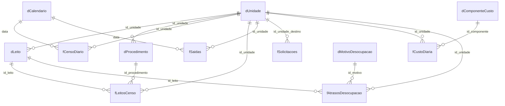

Todas as relações são de um para muitos, com filtro da dimensão para o fato. `fLeitosCenso` e `fAtrasosDesocupacao` chegam a `dUnidade` por dois caminhos (direto e por `dLeito`). No Power BI, mantenha ativa a relação direta com `dUnidade` e deixe a relação com `dLeito` inativa, ou use `dLeito` apenas como filtro de leito. `fSolicitacoes` não tem relação com `dCalendario` porque registra data e hora; crie uma coluna de data se precisar filtrar por dia.

## 7. Medidas para o Power BI (DAX)

```dax
-- Ocupação e permanência (fCensoDiario)
Pacientes-dia = SUM ( fCensoDiario[pacientes_dia] )
Leitos-dia operacionais = SUM ( fCensoDiario[leitos_operacionais] )
Taxa de ocupação = DIVIDE ( [Pacientes-dia], [Leitos-dia operacionais] )
Saídas = SUM ( fCensoDiario[saidas] )
Média de permanência = DIVIDE ( [Pacientes-dia], [Saídas] )
Leitos operacionais médios = DIVIDE ( [Leitos-dia operacionais], DISTINCTCOUNT ( fCensoDiario[data] ) )
Índice de giro = DIVIDE ( [Saídas], [Leitos operacionais médios] )
Intervalo de substituição = DIVIDE ( ( 1 - [Taxa de ocupação] ) * [Média de permanência], [Taxa de ocupação] )
Mortalidade institucional = DIVIDE ( SUM ( fCensoDiario[obitos] ) - SUM ( fCensoDiario[obitos_ate_24h] ), [Saídas] )

-- Censo do momento (fLeitosCenso)
Leitos ocupados = CALCULATE ( COUNTROWS ( fLeitosCenso ), fLeitosCenso[status] = "Ocupado" )
Leitos vagos = CALCULATE ( COUNTROWS ( fLeitosCenso ), fLeitosCenso[status] = "Vago" )
Leitos em limpeza = CALCULATE ( COUNTROWS ( fLeitosCenso ), fLeitosCenso[status] = "Em higienização" )
Leitos reservados = CALCULATE ( COUNTROWS ( fLeitosCenso ), fLeitosCenso[status] = "Reservado" )
Leitos bloqueados = CALCULATE ( COUNTROWS ( fLeitosCenso ), fLeitosCenso[status] = "Bloqueado" )
Ocupação instantânea = DIVIDE ( [Leitos ocupados], COUNTROWS ( fLeitosCenso ) - [Leitos bloqueados] )
Pacientes em vermelho = CALCULATE ( COUNTROWS ( fLeitosCenso ), fLeitosCenso[classificacao_kanban] = "Vermelho" )
% em vermelho = DIVIDE ( [Pacientes em vermelho], [Leitos ocupados] )
Altas do dia = CALCULATE ( COUNTROWS ( fLeitosCenso ), fLeitosCenso[etapa_fluxo] IN { "Alta prevista hoje", "Alta médica dada" } )

-- Demanda do NIR (fSolicitacoes)
Solicitações = COUNTROWS ( fSolicitacoes )
Solicitações pendentes = CALCULATE ( [Solicitações], fSolicitacoes[status] = "Pendente" )
% atendidas = DIVIDE ( CALCULATE ( [Solicitações], fSolicitacoes[status] = "Atendida" ), [Solicitações] )
Mediana de espera (h) = CALCULATE ( MEDIAN ( fSolicitacoes[tempo_espera_h] ), fSolicitacoes[status] = "Atendida" )
% atendidas em até 6 h = DIVIDE ( CALCULATE ( [Solicitações], fSolicitacoes[atendida_ate_6h] = "Sim" ), CALCULATE ( [Solicitações], fSolicitacoes[status] = "Atendida" ) )
Saldo de leitos do dia = [Leitos vagos] + [Leitos em limpeza] + [Altas do dia] - [Leitos reservados] - [Solicitações pendentes]

-- Giro do leito (fSaidas)
Mediana alta até saída (min) = CALCULATE ( MEDIAN ( fSaidas[min_alta_ate_saida] ), fSaidas[tipo_saida] <> "Óbito" )
Mediana giro total (min) = MEDIAN ( fSaidas[min_giro_total] )
% saídas até 10h = DIVIDE ( CALCULATE ( COUNTROWS ( fSaidas ), fSaidas[saida_ate_10h] = "Sim" ), CALCULATE ( COUNTROWS ( fSaidas ), fSaidas[tipo_saida] <> "Óbito" ) )

-- Desocupação e custos (fAtrasosDesocupacao)
Leitos-dia perdidos = SUM ( fAtrasosDesocupacao[dias_atraso] )
Leitos equivalentes = DIVIDE ( [Leitos-dia perdidos], DISTINCTCOUNT ( dCalendario[data] ) )
% leitos-dia perdidos = DIVIDE ( [Leitos-dia perdidos], [Leitos-dia operacionais] )
Pacientes travados agora = CALCULATE ( COUNTROWS ( fAtrasosDesocupacao ), fAtrasosDesocupacao[situacao] = "Em aberto" )
Custo da espera = SUM ( fAtrasosDesocupacao[custo_total] )
Custo por dia dos travados = CALCULATE ( SUM ( fAtrasosDesocupacao[custo_dia_espera] ), fAtrasosDesocupacao[situacao] = "Em aberto" )
Receita não realizada = SUM ( fAtrasosDesocupacao[receita_nao_realizada] )
Impacto total = [Custo da espera] + [Receita não realizada]
```

Medida de situação para formatação condicional e semáforo:

```dax
Situação da ocupação =
VAR t = [Ocupação instantânea]
RETURN
    SWITCH (
        TRUE (),
        t >= 0.90, "Crítico",
        t >= 0.85, "Atenção",
        "Adequado"
    )
```

> As fórmulas seguem os nomes de tabelas e colunas da base, mas não foram testadas no Power BI. Confira os resultados com a aba Conferencia antes de publicar.

## 8. Regras de negócio

### 8.1 Kanban de permanência

| Cor | Regra | Leitura |
|---|---|---|
| Verde | Dias de internação até a metade do tempo de referência | Dentro do prazo |
| Amarelo | Acima da metade e até o tempo de referência | Perto do limite |
| Vermelho | Acima do tempo de referência | Passou do prazo; prioridade no round |

### 8.2 Situação dos tópicos (semáforo)

| Tópico | Crítico | Atenção | Adequado |
|---|---|---|---|
| Ocupação | A partir de 90% ou três unidades nesse patamar | A partir de 85% ou unidade sem vaga | Abaixo disso |
| Leitos que sobram hoje | Saldo negativo | Unidade com saldo negativo ou saldo até 2 | Saldo acima de 2 |
| Permanência (Kanban) | 25% ou mais dos internados em vermelho | A partir de 15% | Abaixo de 15% |
| Desocupação | Atrasos consomem 8% ou mais dos leitos-dia | A partir de 4% ou 3 casos em aberto | Abaixo disso |
| Fila do NIR | Espera pendente acima de 24 h ou menos de 40% atendidos em até 6 h | Espera acima de 6 h ou menos de 60% em até 6 h | Abaixo disso |
| Giro | Menos de 15% das saídas até 10h | Menos de 30% | 30% ou mais |
| Higienização | Três ou mais acima do tempo-alvo | Uma acima do alvo ou três leitos bloqueados | Nenhuma acima do alvo |
| Indicadores | Permanência 15% acima da meta | Permanência acima da meta | Na meta ou abaixo |

### 8.3 Tempos-alvo

| Etapa | Alvo |
|---|---|
| Alta médica até a saída do paciente | 120 min |
| Saída até o início da higienização | 30 min |
| Higienização concorrente | 60 min |
| Higienização terminal | 120 min |
| Espera por leito no NIR | 6 h |

### 8.4 Definições

- **Leitos operacionais.** Leitos instalados menos os bloqueados (manutenção, déficit de equipe, isolamento de coorte, desinfecção).
- **Taxa de ocupação.** Pacientes-dia ÷ leitos-dia operacionais. A ocupação instantânea usa ocupados ÷ leitos operacionais no censo.
- **Saídas.** Altas + óbitos + transferências externas.
- **Média de permanência.** Pacientes-dia ÷ saídas.
- **Índice de giro.** Saídas ÷ leitos operacionais médios do período.
- **Intervalo de substituição.** (1 − taxa de ocupação) × média de permanência ÷ taxa de ocupação.
- **Mortalidade institucional.** Óbitos com 24 h ou mais de internação ÷ saídas.
- **Balanço de leitos do dia.** Vagos + em higienização + altas previstas ou já dadas − reservados − pedidos pendentes. Não considera pedidos que ainda vão chegar.
- **Atraso na desocupação.** Tempo entre a alta médica e a saída do leito por motivo não clínico. Casos em aberto contam até o censo.
- **Custo do dia de espera.** Soma dos componentes da diária × fator que continua no dia de espera: equipe, hotelaria e estrutura a 100%; medicamentos e materiais a 35%; apoio diagnóstico a 15%.
- **Internações não realizadas.** Leitos-dia perdidos ÷ média de permanência da unidade.
- **Receita não realizada.** Internações não realizadas × receita média de AIH da unidade.
- **Leitos equivalentes.** Leitos-dia perdidos ÷ 30.

## 9. Arquitetura técnica do HTML

O `index.html` é um arquivo único, sem servidor, com a biblioteca D3.js 7.9 e os dados embutidos. O código é dividido em seções, cada uma com uma responsabilidade.

| Seção | Responsabilidade |
|---|---|
| 0. Tokens de estilo | Paleta corporativa, tipografia Segoe UI, tamanhos e espaçamentos |
| 1. Marcação | Barra superior, oito telas da sala de situação e as dez abas da análise completa |
| 2. D3.js 7.9 | Biblioteca de gráficos embutida |
| 3. Dados | As bases fictícias embutidas em JSON |
| 4. Motor local | Leitura dos dados, cálculos sob demanda, filtro de unidade e atualização das telas |
| 5. Cálculos | Indicadores do período, censo do momento, balanço do dia, giro, demanda, desocupação, custos e semáforos |
| 6. Gráficos | Barras horizontais e verticais, barras empilhadas, cascata, rosca, linhas, minigráficos e mapas de calor |
| 7. Explicações | Textos dos balões exibidos ao clicar nas barras |
| 8. Análise completa | Abas detalhadas, tabelas ordenáveis e filtros |
| 9. Desocupação e custos | Custo por motivo, componente e unidade; casos em aberto; ações recomendadas |
| 10. Painel de leitos | Cards de todos os leitos, filtros, busca e ficha |
| 11. Resumo comentado | Comunicado do dia e tópicos com detalhamento |
| 12. Sala de situação | Navegação, rodízio, Panorama geral e as demais telas |
| 13. Inicialização | Downloads das bases em CSV e abertura na tela certa |

## 10. Como os dados fictícios foram gerados

- **Semente fixa.** Os dados foram gerados em Python com NumPy e pandas, com sementes fixas, para que o resultado seja sempre o mesmo.
- **Datas relativas.** O censo de referência é 19/10/2026 às 7h. As séries cobrem os 30 dias anteriores, de 20/09 a 19/10/2026.
- **Hospital de 230 leitos.** São dez unidades com perfis diferentes de ocupação, permanência e mortalidade, das enfermarias às UTIs.
- **Permanência realista.** Os dias de internação seguem uma distribuição log-normal em torno do tempo de referência de cada procedimento, o que produz casos longos (cauda à direita).
- **Fluxo do leito.** Cada saída tem horário de alta médica, saída, início e fim da limpeza e nova ocupação, concentrando as altas no fim da manhã e à tarde.
- **Demanda do NIR.** Os pedidos seguem um processo de Poisson, com mais pedidos em dias úteis, e tempos de espera que variam com a prioridade e o destino.
- **Desocupação.** Os 22 casos em aberto foram atribuídos a pacientes internados do retrato. Os 159 casos resolvidos foram distribuídos pelas unidades, com duração típica por motivo (retaguarda e pendência judicial mais longas, transporte mais curto).
- **Custos estimados.** As diárias variam de R$ 980 (Maternidade) a R$ 4.150 (UTI Neonatal), e a receita média de AIH de R$ 1.100 a R$ 9.600. São valores fictícios de ordem de grandeza plausível, não tabelas oficiais.
- **Coerência conferida.** Os indicadores da base foram recalculados de forma independente e conferem com o painel (aba Conferencia).

## 11. Como usar com dados reais

1. Exporte do sistema de gestão hospitalar ou do prontuário (por exemplo Tasy, MV ou AGHU) o censo diário, o retrato dos leitos, as saídas com horários, os pedidos de leito do NIR e os atrasos de desocupação com o motivo.
2. Cole os dados nas Tabelas do Excel mantendo os nomes das colunas. As fórmulas se estendem com a Tabela.
3. Atualize a data de referência em `'LEIA-ME'!B4`.
4. Ajuste as metas em `dUnidade` e `dMetas`, o tempo de referência em `dProcedimento` (SIGTAP ou protocolo próprio) e os custos em `fCustoDiaria` com o custo apurado do hospital.
5. Confira a aba Conferencia.
6. No Power BI, use Obter dados > Excel, selecione as Tabelas, crie as relações da seção 6.4 e cole as medidas da seção 7.

Para refazer a base a partir do painel, na raiz do repositório:

```bash
pip install -r requirements.txt
npm run dados                  # index.html → build/bases.json e build/calculos.json
python scripts/montar_base.py  # build/ → data/base-dados-leitos.xlsx, data/csv/ e data/dados.json
```

O primeiro script lê os dados embutidos no `index.html` e executa os mesmos cálculos do painel. O segundo monta a planilha com as fórmulas, a aba Conferencia, o Dicionario, os CSV e o JSON. Com os dados fictícios, o resultado é idêntico aos arquivos da pasta `data/`.

O caminho alternativo é substituir os dados embutidos no `index.html` pelo conteúdo de `dados.json` gerado a partir da base real, mantendo os mesmos nomes de campos.

## 12. Referências normativas e técnicas

| Tema | Referência |
|---|---|
| Indicadores hospitalares | Ministério da Saúde. Padronização da Nomenclatura do Censo Hospitalar. 2. ed. Brasília, 2002 |
| Política hospitalar e gestão de leitos | Portaria GM/MS nº 3.390/2013 (Política Nacional de Atenção Hospitalar), consolidada na Portaria de Consolidação nº 2/2017 |
| Núcleo Interno de Regulação | Ministério da Saúde. Manual de implantação e implementação: Núcleo Interno de Regulação para hospitais gerais e especializados. Brasília, 2017 |
| Regulação | Portaria GM/MS nº 1.559/2008 (Política Nacional de Regulação do SUS) |
| Cuidados prolongados (retaguarda) | Portaria GM/MS nº 2.809/2012 (Unidades de Internação em Cuidados Prolongados) |
| Atenção domiciliar | Programa Melhor em Casa — Serviço de Atenção Domiciliar (SAD) |
| Tempo de referência e faturamento | Tabela SIGTAP e Sistema de Informações Hospitalares (SIH/SUS — AIH) |
| Metodologia Kanban na gestão de leitos | Cerdeira, A. K. L. A. Metodologia Kanban como estratégia na gestão de leitos no HUPES; Mattos et al. A aplicação do Kanban como ferramenta de gestão em serviços de saúde (Revista Nursing) |

> Confira sempre as versões oficiais e vigentes das normas antes de usar o painel para fins regulatórios.

## 13. Glossário

| Sigla ou termo | Significado |
|---|---|
| AIH | Autorização de Internação Hospitalar |
| CRAS / CREAS | Centro de Referência de Assistência Social / Centro de Referência Especializado de Assistência Social |
| D+ | Dias de internação do paciente (D+5 = quinto dia) |
| Giro | Número de pacientes que ocuparam cada leito no período |
| ILPI | Instituição de Longa Permanência para Idosos |
| Kanban | Gestão visual por cores e etapas do fluxo do leito |
| Leito operacional | Leito instalado e disponível para uso (não bloqueado) |
| Leitos-dia | Soma diária de leitos; um leito ocupado por um dia é um leito-dia |
| MP | Média de permanência |
| NIR | Núcleo Interno de Regulação |
| PS | Pronto-socorro |
| SAD | Serviço de Atenção Domiciliar |
| SIGTAP | Sistema de Gerenciamento da Tabela de Procedimentos do SUS |
| SIH | Sistema de Informações Hospitalares do SUS |
| SISREG | Sistema Nacional de Regulação |
| TO | Taxa de ocupação |
| UCI | Unidade de cuidados intermediários (semi-intensiva) |
| UTI / UTIN | Unidade de Terapia Intensiva / UTI Neonatal |

## 14. Limitações e cuidados

- **Dados fictícios.** Os números servem para demonstrar o método, não para comparar com hospitais reais.
- **Custos estimados.** Diárias, fatores de custo e receitas de AIH são premissas ilustrativas; use o custo apurado do hospital antes de decidir.
- **Retrato do momento.** O censo é das 7h; leitos mudam de situação ao longo do dia.
- **Balanço do dia.** Não inclui pedidos que ainda vão chegar nem altas não registradas.
- **Medianas de etapas.** A soma das medianas de cada etapa não é igual à mediana do giro total.
- **Tempo de referência.** O Kanban depende da qualidade do tempo de referência por procedimento.
- **Fórmulas DAX.** Não foram testadas no Power BI.
- **Privacidade.** Com dados reais, use pseudonimização (iniciais e prontuário) e siga a LGPD.

## 15. Histórico de versões

| Versão | Data | Mudanças |
|---|---|---|
| 1.0 | 19/10/2026 | Sala de situação com oito telas, análise completa com dez abas, estilo corporativo, balões de explicação nos gráficos, base em modelo estrela com Conferencia e Dicionario |
| 1.1 | 19/10/2026 | Painel publicado no GitHub Pages, galeria de telas, imagem de pré-visualização social, scripts de extração e montagem da base e guia de configuração do repositório |

O detalhamento está no [CHANGELOG](CHANGELOG.md).

---

### Autoria

Larissa Almeida · [github.com/larissahorrara](https://github.com/larissahorrara)
